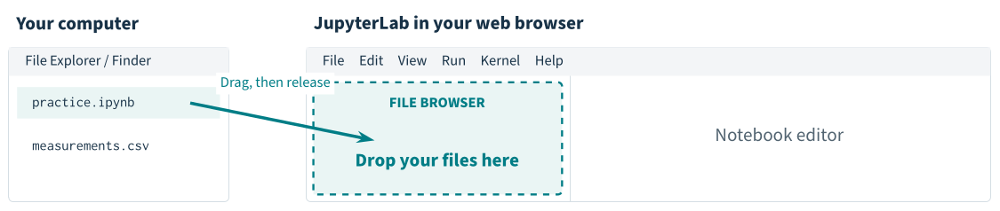

# Getting started with JupyterLab

A tutorial for students to read, run and edit, using **NumPy, SciPy and Matplotlib**. Allow about 40–50 minutes, plus an optional 10-minute exercise. This is a practice environment; actual exams use the course's own server.

**[Open the tutorial in JupyterLab](https://jupyter.org/try-jupyter/lab/?fromURL=https%3A%2F%2Fraw.githubusercontent.com%2Fupatras-lar%2Fjupyter-tutorial%2Fmaster%2Fmeasurements.csv&fromURL=https%3A%2F%2Fraw.githubusercontent.com%2Fupatras-lar%2Fjupyter-tutorial%2Fmaster%2Fjupyterlab_tutorial.ipynb)** · [Read the PDF](jupyterlab_student_guide.pdf) · [View the notebook](jupyterlab_tutorial.ipynb)

This link opens the official Jupyter demo and loads the notebook and sample CSV. No account or local installation is needed. If asked to choose a kernel, select Python; its label may include XPython or Pyodide.

## Work through the notebook

Run cells in order with **Shift+Enter**. Edit the examples, change the number of sample points, redraw a figure, and try the exercises. The “check your answer” cells give feedback when you complete an exercise.

The notebook includes explanations, equations, an interface map and a diagram showing where to drop uploaded files. Both diagrams are embedded, so they stay with a downloaded notebook. The CSV exercise can be completed later if the data file has not been uploaded yet.

**Save and download your work:** saving in the public demo writes to browser storage. To keep your notebook on your computer, save it, then right-click its `.ipynb` filename in the left file browser and choose **Download**.

## Upload the files yourself

This route also lets you practise uploading a notebook:

1. Download this repository using **Code → Download ZIP**, then extract it on your computer.
2. Open the [official JupyterLab demo](https://jupyter.org/try-jupyter/lab/).
3. Drag `jupyterlab_tutorial.ipynb` and `measurements.csv` from your computer's file manager onto the **file browser on the left**. You can also use its **Upload Files** button.
4. Double-click `jupyterlab_tutorial.ipynb` in that file list. Select a Python kernel if asked, then follow the notebook.



GitHub displays a static notebook preview. Open the notebook in JupyterLab to run code and complete the exercises. [GitHub's notebook documentation](https://docs.github.com/en/repositories/working-with-files/using-files/working-with-non-code-files#working-with-jupyter-notebook-files-on-github)

## Files

| File | Purpose |
| --- | --- |
| [jupyterlab_tutorial.ipynb](jupyterlab_tutorial.ipynb) | Interactive tutorial and practice cells. |
| [measurements.csv](measurements.csv) | Small input file for the upload and NumPy exercise. |
| [jupyterlab_student_guide.pdf](jupyterlab_student_guide.pdf) | Printable eight-page guide. |
| [jupyterlab_student_guide.tex](jupyterlab_student_guide.tex) | LaTeX source, including both interface diagrams. |
| [assets/](assets/) | Diagram images used by the README and embedded in the notebook. |

## Run locally

Use Python 3.10 or newer. Create and activate a virtual environment, then install the packages and start JupyterLab:

```sh
python -m venv .venv
```

Activate it with `source .venv/bin/activate` on Linux/macOS, or `.venv\Scripts\Activate.ps1` in Windows PowerShell. Then run:

```sh
python -m pip install -r requirements.txt
jupyter lab jupyterlab_tutorial.ipynb
```

## Maintain the tutorial

Edit the notebook directly in JupyterLab. Clear its outputs and save it before committing; expected numerical results are written in the explanatory cells. Edit the printable guide in the `.tex` file.

With `latexmk` and the required LaTeX packages installed, rebuild the PDF with:

```sh
make
```

After changing an interface diagram in the LaTeX source, `make notebook-figures` regenerates the images and updates their notebook attachments. This also needs `pdftocairo` from Poppler and the notebook development dependencies.

To validate the notebook in fresh kernels:

```sh
python -m pip install -r requirements-dev.txt
make check
```

The check covers normal execution, a notebook uploaded without the CSV, completed exercise answers, and generated CSV/PNG files. Test execution uses temporary folders and leaves the distributed notebook's outputs empty.

The online launch links target `upatras-lar/jupyter-tutorial` on branch `master`. They use JupyterLite's [external URL extension](https://jupyterlite.readthedocs.io/en/stable/howto/content/open-url-parameter.html), which is included in the [official demo's configuration](https://github.com/jupyter/try-jupyter/blob/main/pyproject.toml).

## License

This project is licensed under the [MIT License](LICENSE).
